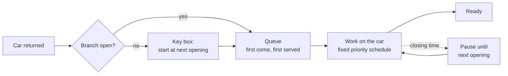

# Task Time Detective — Predicting Car Rental Turnaround Times


Hackathon project for a **SIXT** challenge: when a rental car comes back, how long does each preparation
task take, and when will the car be ready for the next customer?

The data only contains the **total** turnaround time per car, never the time of each task. We
reconstructed how a branch actually works (staff schedule, queue, opening hours) and built a model that
predicts all **9 task durations** and the **total time** for every car.

## Results

Measured on the labelled validation week with **leave-one-day-out** evaluation, so no model ever saw
the day it predicts.

| Metric | Baseline | **Our model** | Challenge "Strong" target |
|---|---|---|---|
| Total turnaround MAE | ~99 min | **7.7 min** (5.8 on held-out weeks) | < 5 min |
| Per-task WAPE | ~0.55 | **0.075** | < 0.2 |
| Mean per-task MAE (9 tasks) | – | **2.67 min** | – |
| Negative / impossible durations | 1,575 | **0** | 0 |

- The total turnaround error is **13× lower** than the baseline.
- The per-task error is far inside the "Strong" target.
- More than half of the remaining total error comes from just **13 of 2,791 cars**. Their work finished
  right around closing time, where a few minutes decide between "ready tonight" and "ready tomorrow".
- Two runs give **byte-identical** predictions, and fit + predict takes about **5 seconds** on a laptop.

## How it works



We found these rules by checking the true task times in the labelled week:

1. **The tasks of one car are split across the staff in a fixed order.** A damage repair always comes
   first. Interior cleaning waits for special cleaning, and electric charging runs in parallel. This rule
   reproduces **97–98 %** of quiet-branch totals exactly.
2. **Cars wait in a first-come, first-served queue.** Each car ahead adds about 12 minutes divided by the
   number of staff.
3. **Work only happens while the branch is open.** Unfinished work pauses at closing and continues at the
   next opening.
4. **Task durations simply add up.** For example, a child seat adds the same ~7.6 min of interior
   cleaning at every dirt level.

### Models

| Part | Model |
|---|---|
| 7 frequent tasks | Median (L1) linear regression per task, with an L1 penalty chosen per task |
| Quick damage repair | Gradient-boosted trees, trained on ~1,100 durations backed out of the totals |
| Tyre check | Median per branch staffing level (only 29 labelled examples) |
| Waiting time | Gradient boosting (absolute-error loss) on arrival history and closing-time features |
| Total | Open-minute clock: return time + predicted wait + predicted work time |

The models learn effects a branch manager would recognize. For example, a reported smoking car adds about
8 min of special cleaning, and an empty EV battery needs about 40 min of charging. The full analysis is in
[`SUBMISSION.md`](SUBMISSION.md).

## Quick start

```bash
git clone https://github.com/mohamedbenothman-lab/Tougypt.git
cd Tougypt
pip install -r requirements.txt     # Python 3.11+

cd starter
python run.py --repeat              # fit + predict on the validation week, check determinism
python validate_cv.py               # honest leave-one-day-out evaluation
python evaluate_local.py predictions_cv.csv --labels ../data/validation_labels.csv --flags ../data/validation.csv
```

## Repository structure

```
├── data/                      # Synthetic turnaround data (train, validation, branch info)
├── starter/
│   ├── solution.py            # Main model: fit() and predict()
│   ├── run.py                 # Train, predict, and check reproducibility
│   ├── validate_cv.py         # Leave-one-day-out evaluation
│   ├── evaluate_local.py      # Scoring metrics (MAE, WAPE, plausibility checks)
│   ├── linear_regression.py   # Baseline model
│   └── validate_codex.py      # Alternative model used for comparison
├── submission/
│   ├── slides.pdf             # 5-slide project summary
│   └── test_predictions.csv   # Predictions on the hidden test set
├── SUBMISSION.md              # Full write-up: approach, results, feature effects
├── VALIDATION_EXPERIMENTS.md  # Experiments with an alternative model
└── CHALLENGE.md               # Original challenge description
```

## Key learnings

- **Understanding the process beat a bigger model.** Rebuilding the branch's schedule and queue did more
  than any amount of model tuning.
- **Simple models win when the effects are additive.** Median linear regression beat gradient boosting
  on every frequent task.
- **Honest validation matters.** All reported numbers come from leave-one-day-out evaluation or
  held-out weeks, never from data the model was trained on.

---

The dataset is synthetic and was provided by the challenge organizers. It contains no real customer data.
